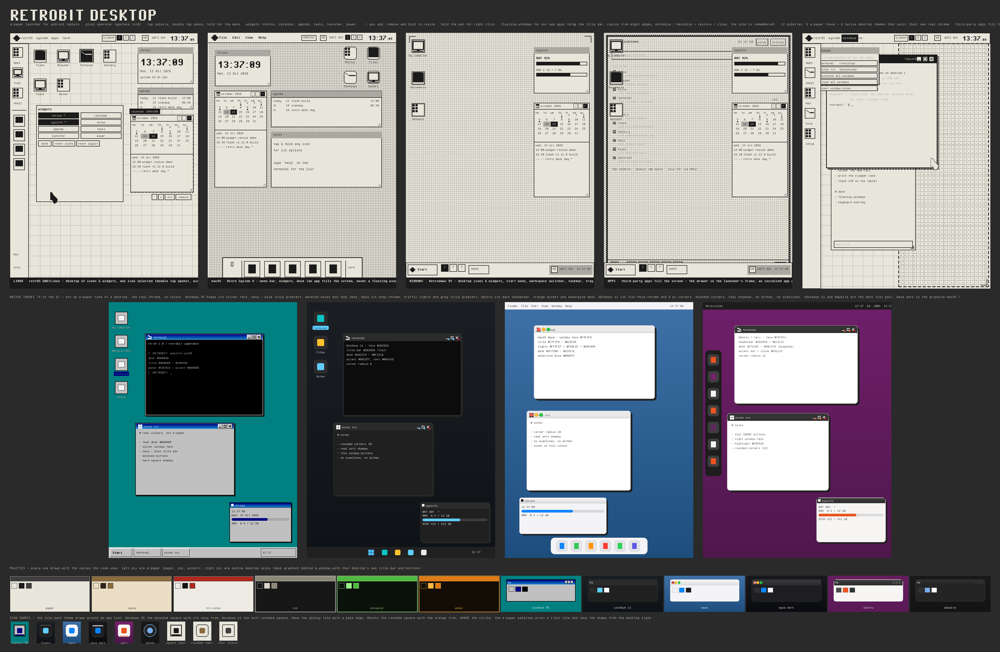
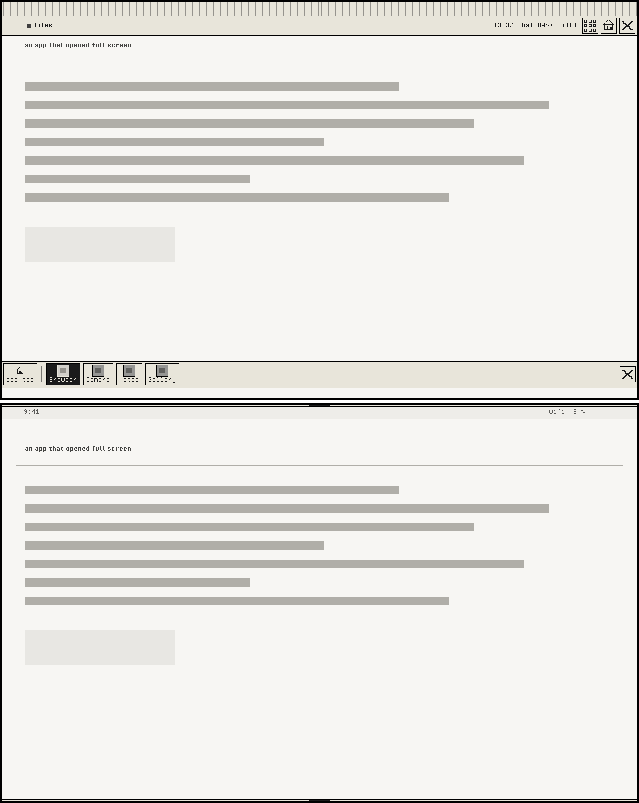

# Retrobit Desktop

**Launcher Android native bergaya komputer retro dengan layar e-paper** — dibuat untuk tablet
(Huawei MatePad Mini, 8.7" 2560×1600, dukungan M-Pencil) tapi berjalan di perangkat Android apa pun
(Android 8.0+).

Bukan skin: ini launcher asli Android (`CATEGORY_HOME`) yang dibangun dengan **Kotlin + Jetpack Compose**,
lengkap dengan window manager, tiga gaya desktop yang bisa dipilih, dan sistem visual e-paper
(dithering, halftone, tanpa animasi mengganggu).

```
┌───────────────────────────────────────────────────────────────────────┐
│ ◆ retrOS  system  apps  term      [apps] [notes]  [LINUX]  88%  WIFI  │
├────┬──────────────────────────────────────────────────────────────────┤
│ ▤  │  ┌── terminal ─────────────────────────────┐   ┌── chrono ─────┐ │
│ ⌕  │  │ operator@retrobit:~$ neofetch           │   │   13:37       │ │
│ ▤  │  │   .-------------------.                 │   │ Mon, 13 Oct   │ │
│ ── │  │   |  | retR0BIT  _ |  |                 │   └───────────────┘ │
│ 📁 │  │   '-------------------'                 │   ┌── sysinfo ────┐ │
│ ⚙  │  └─────────────────────────────────────────┘   │ BAT 87% ▓▓▓▓  │ │
│    │                                                └───────────────┘ │
└────┴──────────────────────────────────────────────────────────────────┘
```

## Tampilan





*Mockup dari palet, font, dan tata letak yang dipakai kode aslinya — dibuat ulang dengan
`tools/mockup.py`. Hasil di perangkat mengikuti kode Compose yang sama.*

## Fitur

### Tiga gaya desktop (bisa diganti kapan saja, dari pengaturan / terminal / chip di panel)

| Gaya | Ciri khas |
| --- | --- |
| **Linux** (`retrOS GNU/Linux`) | panel atas dengan menu sistem, **side dock** di kiri, ikon grid, widget di kanan atas (tanpa task list: aplikasi memenuhi layar) |
| **macOS** (`Retro System 9`) | **menu bar** atas (File/Edit/View/Help), **dock** bawah, **Launchpad**, **Spotlight** (⌘/meta atau tombol cari) |
| **Windows** (`Retrodows 95`) | **start menu** dua kolom, **taskbar** + system tray, ikon desktop bertumpuk di kiri, tombol & panel ber-bevel dither khas Win95 |

### Sistem visual: e-paper, plus tema desktop yang **asli**
- **12 palet**, dua keluarga yang benar-benar berbeda cara menggambarnya:
  - **E-paper** (6): Paper, Sepia, Tri-color (B&W + aksen merah), Ink (dark), Phosphor (hijau CRT),
    Amber. Satu nada kertas + satu nada tinta, dicetak dengan mesin e-paper launcher: **dither**,
    bayangan keras satu kotak, garis scanline, caption &#8220;cetakan&#8221;, title bar 1-bit. Cocok
    dengan gaya desktop apa pun.
  - **Tema desktop bawaan** (6): **Windows 95**, **Windows 11**, **Aqua** dan **Aqua dark** (macOS),
    **Ubuntu** (Yaru/GNOME), **Adwaita** (GTK 4 / libadwaita). Ini **bukan** versi e-paper dari
    desktop itu — palet-palet ini menggambar **chrome desktop yang sebenarnya**, dengan warna asli:
    | Tema | Yang digambar |
    | --- | --- |
    | Windows 95 | muka jendela perak `#C0C0C0`, bingkai hitam, **title bar gradient navy `#000080` > biru `#1084D0`**, tombol kotak ber-bevel, sudut **persegi**, bayangan kotak keras, desktop teal `#008080` |
    | Windows 11 | permukaan Mica `#202020`, teks putih, **title bar rata `#2B2B2B`**, tombol glyph polos dengan **dot aksen** `#60CDFF`, sudut membulat 8 dp, bayangan lembut, desktop `#1B1F24` > `#0F1216` |
    | Aqua / Aqua dark | chrome salju `#F4F4F6` (dark: `#1E1E20`), **title bar gradient** `#F7F7F8` > `#DCDCDE`, **traffic lights** merah `#FF5F57` / kuning `#FEBC2E` / hijau `#28C840` di kiri, sudut 10 dp, seleksi biru sistem `#0A84FF`, desktop slate blue `#3F72A8` > `#1E4E7E` |
    | Ubuntu | muka jendela terang `#F6F5F4`, **headerbar gelap** `#3D3D3D` > `#2C2C2C`, tombol GNOME rata, aksen oranye `#E95420`, sudut 12 dp, desktop aubergine `#77216F` > `#4B1749` (**diagonal**) |
    | Adwaita | abu-abu libadwaita `#242424`, headerbar `#303030` > `#242424`, aksen `#78AEED`, sudut 12 dp, desktop `#1A1A1A` > `#141414` |
  - **Jadi tidak ada ranjau e-paper di tema native**: tanpa dither, tanpa scanline, tanpa
    registration mark / caption cetakan, tanpa bayangan cetak. Ikon, label, wallpaper, dan widget
    memakai warna asli (ikon berwarna penuh, label putih di atas desktop gelap, plate seleksi
    memakai warna highlight desktop itu — navy di Win95, biru sistem di Aqua, oranye di Ubuntu).
  - **Widget ikut tema juga** (lihat bagian *Widget desktop* di bawah): di tema native widget
    memakai muka jendela tema, sudut membulatnya, warna border tema, **bar judul bergradasi tema**
    (navy→biru di Win95, abu di Aqua, gelap di Ubuntu/Adwaita, rata di Win11/GNOME), **meter
    beraksen tema** di atas muka lembut, dan bayangan lembut. Di palet e-paper widget tetap
    tercetak: strip header ber-hatch, sel tinta, dan bayangan kotak keras.
  - Memilih tema bawaan sekaligus memindahkan **desktop style** yang cocok (Win95/Win11 → Windows,
    Aqua/Aqua dark → macOS, Ubuntu/Adwaita → Linux) dan ikon jadi berwarna; gaya & mode ikon itu
    masih bisa diganti lagi setelahnya. Palet e-paper tidak pernah menyentuh keduanya.
  - Di *Settings - palette* setiap palet ditampilkan sebagai **pratinjau**: warna desktop + plat
    jendela + title bar aksen + namanya. Terminal: `palette` (daftar + warna sekarang),
    `palette win95`, `palette aqua-dark`, `palette ubuntu`, …
  - **Tema ikon ikut palet.** Setiap tema desktop membawa **bentuk ikon** yang desktop itu pakai:
    Windows 95 kotak ber-bevel dengan trim navy, Windows 11 kotak membulat halus, Aqua tile
    membulat dengan edge pucat dan kilau kaca, Ubuntu kotak membulat dengan trim oranye,
    GNOME lingkaran dengan cincin tipis. Palet e-paper mencetak tile 1-bit dan mengambil bentuk
    dari **desktop style** (Windows kotak, macOS membulat, Linux rata). Mengganti palet otomatis
    mengganti bentuk ikon; kalau mau, bentuknya bisa **dipin** di *Settings - app icon shape* atau
    lewat `icons shape <nama>`, dan pilihan itu bertahan sampai palet berikutnya dipilih.
  - Perintah `invert` membalik kertas ⇄ tinta (night mode memakai palet Ink dan kembali ke palet
    harimu saat dimatikan) — dan **melepas skin native**, karena &#8220;Windows 95 gelap&#8221; tidak
    pernah ada; night mode selalu kembali ke mesin e-paper.
- **Wallpaper** digambar di atas **warna desktop** palet (untuk palet e-paper warna itu = warna
  kertasnya sendiri), jadi pola dither selalu berada di latar yang benar. Di tema native wallpaper
  tidak di-dither: gambar tetap **berwarna** (posterisasi lembut 16 level) di atas desktop aslinya.
  Tiga sumber, semuanya coret-asal di palet e-paper.
  - *Pattern* — enam pola dither bawaan (halftone dots, grid, stipple Bayer 4×4, hatch, polos).
  - *Device* — wallpaper tablet kamu, dibaca lewat WallpaperManager, di-crop, diturunkan resolusinya
    ke ~260 sel lalu di-dither ulang (satu sel = satu titik tinta/kertas).
  - *Image* — gambar apa pun dari penyimpanan (Android Photo Picker). Pilihanmu disimpan sebagai
    URI persistable.
  Tiga **tone** untuk sumber gambar: `Halftone` (titik rapat), `Gray` (garis scanning halus),
  `Soft` (blok besar, kontras rendah). Warna aslinya dibuang — hanya kertas, tinta, dan abu-abu.
- **Ikon aplikasi dirender ulang**: `Color` (asli), `Mono` (grayscale ke ramp tinta→kertas),
  `1-bit` (halftone Bayer + outline, di-scale nearest-neighbour agar pixelnya tajam).
- **Ikon mengikuti palet, dan sekarang benar-benar berubah**: **semua palet punya accent**, jadi
  bingkai + bingkai band ikon ikut berubah warna di Paper, Sepia, Tri-color, Ink, Phosphor, dan
  Amber. Ada **plat huruf pertama** aplikasi di sudut ikon supaya aplikasi dengan ikon mirip tetap
  bisa dibedakan, dan **chip nama** tercetak di bawah tiap ikon desktop. Ketiganya bisa dimatikan di
  *Settings - app icon readability*.
- **Bug ikon "tidak berubah" sudah diperbaiki**: `rememberAppIcon` dulu menyimpan bitmap lama saat
  palet/mode/bentuk/accent berubah (guard `value == null` tidak pernah lolos), jadi ikon terus
  memakai gambar lama. Sekarang **setiap kunci render selalu digambar ulang**, dan ada tombol
  `re-ink icons now` plus epoch yang memaksa seluruh desktop menggambar ulang ikonnya.
- **Pratinjau ikon hidup di Settings**: *Settings - app icon look (live preview)* menampilkan ikon
  aplikasi kamu sendiri persis seperti di desktop (palet + mode + bentuk + plat huruf), plus
  perbandingan `Color` / `Mono` / `1-bit` / `invert` dan tombol `re-ink icons now`.
- **Bentuk bingkai ikon mengikuti tema**: `Auto` (Linux → square flat, macOS → rounded, Windows →
  bevel klasik), atau pilih manual: `Classic`, `Rounded`, `Flat`, `Plain`. Cache ikon otomatis
  dibuang saat tema/bentuk/mode/palet/skala berubah.
- **Jam menampilkan detik** (opsional, `Settings` atau `seconds on|off`) — jam di panel, taskbar,
  dan widget ikut berubah.
- Chrome: bevel tebal, bayangan *checker dither*, separator ber-*hatch*, title bar ber-bayangan
  dither, marquee tanpa animasi, dan pola scanline halus.
- Semua ikon UI digambar sebagai **pixel-art 16×16** (glyph didefinisikan di dalam kode).

### Cyberdeck chrome: bingkai yang menggambar "jendela" di atas aplikasi
- Setiap aplikasi **pihak ketiga** terbuka **penuh** (launcher tidak pernah meminta floating window),
  jadi launcher sendiri yang **menggambar bingkainya di atas aplikasi**: border hitam 3,5 dp, **title rail**
  (nama aplikasi, jam `HH:mm:ss`, baterai, sinyal, dan tombol `hide` / `eye` / `desktop` / `panel` /
  `keyboard`) serta **dock** di bawah (kunci desktop, aplikasi yang dipin, tombol panel). Itulah
  yang membuat aplikasi full screen terbaca sebagai jendela dari desktop ini.
- Menyalakannya: *Settings - cyberdeck chrome → Draw the desktop frame over full-screen apps*
  (butuh izin **display over other apps**, ada tombol `grant permission`), tombol `preview 8s` untuk
  mencoba tanpa keluar dari desktop, atau terminal: `cyberdeck on|off|preview|grant`.
- Chrome hanya muncul saat launcher tidak terlihat (kalau desktop yang di depan, launcher menggambar
  bingkainya sendiri — lihat *Jendela mengambang untuk aplikasi bawaan*). Tengah layar tidak ditutup
  overlay apa pun, dan dock diberi jarak dari gesture bar supaya swipe-naik (home) tetap jalan.
- **Bingkai selalu hitam**, judul rail dimulai setelah lubang kamera, dan **rail auto-hide**:
  setelah beberapa detik title rail + dock menyusut jadi handle tipis di tepi layar (sentuh untuk
  memunculkan; rail juga muncul sebentar tiap ganti aplikasi). Atur di *Settings - cyberdeck chrome*
  atau lewat terminal `cyberdeck autohide on|off|6`.
- Tulisan rail/dock di-snap ke grid font 16 px dan ikon dock memakai **ikon asli aplikasi**
  (grayscale), jadi mudah dibaca.

### Aplikasi pihak ketiga: satu aplikasi, satu layar
- Aplikasi terpasang yang dibuka dari desktop/dock/drawer tetap membuka **penuh**, dan bingkai
  cyberdeck digambar di sekelilingnya oleh `ChromeService` (overlay). Launcher **tidak pernah**
  meminta Android membuat floating window (freeform) — tidak perlu izin sistem tambahan, dan tidak
  ada aplikasi pihak ketiga yang ditaruh di dalam kotak oleh launcher.
- Untuk aplikasi pihak ketiga, bingkai itu memang seluruh "jendela"-nya: rail atas (nama aplikasi,
  jam, baterai, sinyal, `hide` / `eye` / `desktop` / `panel` / `keyboard`) dan dock bawah.

### Jendela mengambang untuk aplikasi bawaan launcher
- **Tujuh aplikasi bawaan** — terminal, settings, notes, applications (drawer), system monitor,
  calendar, about — dibuka sebagai **jendela kotak di desktop**, bukan langsung full screen:
  - **geser** dari title bar, **resize dari 8 arah** (4 sisi + 4 sudut, pegangan di luar bingkai),
  - **minimize**, **maximize** (mengisi area desktop; rail & dock tetap terlihat) dan
    **maximize lagi = restore ke ukuran semula**, **close** (tombol `x`),
  - **ukuran & posisi terakhir diingat per aplikasi** dan per halaman desktop, jadi jendela terbuka
    persis seperti kamu tinggalkan.
- **Double tap / double click di title bar** = maximize / restore. Menyeret jendela ke **tepi kiri
  atau kanan** memenuhi setengah desktop, menyeret ke **atas tengah** = maximize — dengan pratinjau
  garis putus-putus saat masih diseret.
- **Daftar jendela** (task list) bisa dibuka dari panel Linux (`windows`), menu **Window** macOS,
  tombol taskbar Windows 95, atau terminal `win list`. Di situ ada `minimize all`, `close all`, dan
  **`reset window sizes`** — kalau ukurannya sudah kacau, semua jendela balik ke ukuran bawaan.
- **Keyboard tidak menggeser jendela**: buka keyboard dan bingkai, judul, posisi, serta ukuran
  jendela tetap di tempatnya (mode keyboard `overlay`; lihat bagian keyboard di bawah).
- Shortcut: `ctrl+alt+t` terminal, `ctrl+alt+w` tutup jendela aktif, `ctrl+alt+m` minimize semua,
  `ctrl+alt+up` maximize, `ctrl+alt+tab` pindah jendela, `ctrl+alt+left/right` & `ctrl+alt+1..4`
  berpindah halaman desktop (tiap halaman punya jendelanya sendiri; `win send 2` memindahkan).
- Terminal: `win`, `win open terminal`, `win min`, `win max`, `win close`, `win closeall`,
  `win reset`, `win next`, `win send <1..4>`.

### Quick panel & dock pintar
- **Quick panel** (tombol gear di rail, terminal `panel`): brightness (drag + `B-`/`B+`/`auto`),
  rotation lock, night mode (palet ink), toggle chrome/rail/dock, auto-hide on/off + 4/6/10/20s,
  daftar aplikasi untuk dibuka (tap = buka penuh, hold = shell-nya di terminal), dan daftar
  **no chrome for** (izin bingkai per aplikasi).
- **Dock pintar**: pembatas dock adalah tombol **pinned / most used first** (`rail mode pinned|used`).
  Dua app pertama yang dipin tetap, sisanya diisi aplikasi yang paling sering dibuka; berlaku di dock
  desktop, sidebar, taskbar, widget launcher dan dock cyberdeck. Tahan app di dock cyberdeck untuk
  pin/unpin (chip yang dipin diberi tanda), dengan konfirmasi singkat di rail (`pins`).
- **Ukuran rail & dock**: `compact` / `normal` / `large` / `huge` (Settings, quick panel, atau
  `cyberdeck size ...`). Ini skala chrome sendiri, jadi tinggi rail, ukuran huruf, ikon dan area
  sentuh tombol ikut berubah tanpa mengubah skala desktop.
- **Quick panel selalu hidup**: tombolnya memanggil launcher langsung (bukan broadcast yang hanya
  terdaftar saat launcher di depan), dan brightness-nya dibawa oleh window overlay - jadi mengatur
  layar dari dalam aplikasi lain benar-benar terasa.
- **Hemat baterai**: saat layar mati, tick chrome berhenti dan rail diturunkan ke handle; rail yang
  auto-hidden tidak digambar ulang tiap detik.
- **Per-app rules**: aplikasi tertentu bisa dikecualikan dari bingkai; kalau app itu di depan, rail
  muncul 4 detik dengan alasannya + cara mengembalikannya.
- Status hidup: jam `HH:mm:ss` (detik tepat di batas detik, juga di widget chrono dan header
  quick panel), gauge baterai + bar sinyal yang digambar, dan tombol **keyboard** di rail & dock
  untuk memunculkan keyboard layar aplikasi depan. Di layar sempit rail melepas readout lebih dulu
  supaya judul aplikasi tidak tertimpa.
- UX: tap pada rail kosong atau handle = sembunyikan/munculkan rail, area sentuh tombol diperbesar,
  tombol `eye` menyembunyikan rail hanya untuk app itu, dan setiap aksi mengeluarkan konfirmasi.

### Ikon aplikasi: mode, warna, dan bentuk yang mengikuti tema
- **Tiga mode render**: `Color` (artwork asli), `Mono` (grayscale dipetakan ke ram kertas→tinta), dan
  `1-bit` (halftone Bayer, ditampilkan nearest-neighbour supaya tetap tajam). Terminal:
  `icons color|mono|dither`.
- **Bentuk tile mengikuti palet**: lihat bagian *Sistem visual* di atas. Bentuknya bisa dilihat
  hidup di *Settings - app icon shape* (deretan chip yang menggambar app asli kamu dalam setiap
  bentuk, memakai warna palet aktif), dipin lewat chip atau `icons shape <nama>`, dan kembali
  otomatis ke tema dengan `icons shape auto`.
- **Trim & warna ikut tema**: tile memakai muka jendela tema sebagai plat, warna teks tema sebagai
  garis bingkai, dan aksen tema sebagai trim (pita bawah Win95, trim Yaru, cincin GNOME), jadi
  aplikasi pihak ketiga tetap terlihat seperti bagian dari desktop yang aktif.
- **Huruf penanda** (`letters`, default aktif) mencetak inisial aplikasi di pojok tile — setelah
  di-dither, ikon folder asing sulit dibedakan — dan **re-ink icons now** membuang cache bitmap
  supaya semua ikon digambar ulang dari sumbernya.

### App drawer: daftar yang bisa digulir, yang paling sering dipakai di atas
- **Punya layar sendiri**: *Applications* terbuka **penuh** seperti aplikasi lain (bingkai + title
  rail + dock, digambar launcher sendiri) dan isinya **daftar** satu baris per aplikasi yang bisa
  digulir — ikon, nama, nama paket, dan berapa kali aplikasi itu dibuka (`x12`).
- **Urutannya: paling sering dipakai dulu, baru A–Z**. Setiap pembukaan app dicatat (disimpan di
  preferensi sebagai `pkg=count`), lalu daftar dibagi dua bagian dengan label pemisah:
  **most used** dan **all apps, a-z**. Jadi aplikasi yang kamu pakai tiap hari selalu di paling atas,
  tanpa perlu menyusun atau menyematkan apa pun. Terminal: `usage` (10 teratas) dan `usage clear`
  (lupakan hitungan, kembali A–Z).
- **Panel launchpad (gaya macOS) sekarang panel, bukan layar penuh**: ukurannya ± 62% × 76% layar,
  punya kolom pencarian dan daftar yang sama. Tap di desktop yang digelapkan untuk menutupnya.
- Urutan yang sama juga dipakai **Spotlight** (6 aplikasi teratas saat pencarian kosong) dan
  daftar aplikasi di **start menu** gaya Windows. Kotak pencarian tetap memfilter dalam urutan itu,
  jadi `spo` langsung memunculkan Spotify kalau memang itu yang paling sering kamu buka.

### Widget desktop: bisa ditambah, dihapus, diatur

- **Widget mengikuti tema palet.** Di palet e-paper widget **tercetak** seperti sebelumnya (kertas,
  bingkai tinta, header ber-hatch, meter sel tinta). Di tema native widget menggambar chrome
  desktop aslinya: muka jendela tema + **sudut membulat** + border tema, **bar judul dengan gradient
  milik tema itu** (Win95 navy→biru, Aqua abu salju, Ubuntu/Adwaita gelap, Win11 rata) dengan teks
  berwarna header, **meter beraksen tema** di atas muka lembut (bukan blok tinta), bayangan lembut,
  dan bingkai putus-putus mode edit memakai **warna aksen** tema dengan sudut membulat. Kalender
  memakai warna seleksi tema untuk hari yang dipilih; setengah sel meter yang lama `mid` tetap
  dipakai di e-paper saja.
- **Delapan widget siap pakai** (`Add widget:` di menu desktop, panel mode edit, Settings, terminal):

  | Widget | Isinya |
  | --- | --- |
  | `chrono` | jam besar (detik sejajar dengan menit saat `seconds on`), tanggal, hari + uptime |
  | `calendar` | bulan berjalan yang ringkas: header dengan `<` `>` `+`, grid hari tanpa kotak, satu baris ringkasan hari terpilih, maksimal 3 entri |
  | `agenda` | 14 hari ke depan, satu baris per entri (`today 15 flash build 14:00`) |
  | `tasks` | task yang belum selesai, kotak `-` sekali tekan untuk menandai selesai |
  | `launcher` | pintasan ke aplikasi yang di-pin di dock, satu tekan langsung jalan |
  | `power` | persentase baterai besar, bar, status charge, koneksi |
  | `sysinfo` | baterai, RAM, dan disk dengan bar bertingkat |
  | `notes` | lima baris pertama dari notes, satu tekan membuka aplikasi Notes |

- **Desktop bersih tanpa teks bantuan**: tidak ada lagi label `no widgets`, `desktop is empty`,
  `marked * are on the desktop`, atau hint `hold a widget to ...` di homescreen. Widget kosong
  cukup tampil sebagai kartu kosong, dan mode edit ditandai bingkai putus-putus.
- **Widget bisa ditambah atau dihapus dari homescreen**:
  - **tekan lama (hold) / klik kanan di desktop kosong** → menu desktop berisi
    `Add apps or widgets to the desktop…` (panel lengkap dengan pencarian aplikasi), lalu
    `Add widget: <nama>` / `Remove widget: <nama>` untuk tiap widget, plus `Edit widgets`;
  - di **mode edit** ada panel `widgets` di bawah kolom widget (delapan tombol toggle, yang aktif
    ditandai `*`), lengkap dengan `done`, `reset sizes`, dan `reset layout`;
  - lewat **Settings - display widgets** (daftar `[x] CLOCK`, tombol `add`/`remove`, `^`/`v` untuk
    mengurutkan) dan lewat terminal: `widget add notes`, `widget remove clock`, `widget layout`.
- **Semua widget bisa diatur ukurannya dengan hold**: tekan dan tahan widget mana pun — ia langsung
  masuk mode resize (seluruh badan widget jadi handle) dan tepi/sudut terdekat mengikuti pena atau
  jari. Tanpa hold pun bisa: tarik tepi kanan (lebar), tepi bawah (tinggi), atau grip sudut
  kanan-bawah (keduanya). Ukuran di-snap ke grid 8 px, minimum 160x56 dp, diingat per widget.
- **Mode edit widget** (`Edit widgets`, terminal `widget edit on`): widget dikelilingi bingkai
  putus-putus, ada chip nama + ukuran hidup (mis. `calendar 280x300`), tombol `^` `v` `fit`
  `remove` di bawah tiap widget, dan isi widget tidak menerima sentuhan supaya tidak salah tekan.
- **Hold di tengah widget** meresize ke arah yang paling dekat: bagian kiri/kanan widget mengubah
  lebar, bagian atas/bawah mengubah tinggi — jadi hold tidak mengubah lebar dan tinggi sekaligus.
- **Keluar dari mode edit gampang**: tap di desktop kosong, tombol `done`, tekan `Esc`, atau
  pilih `Done editing widgets` di menu desktop.
- **Hold-to-edit bisa dimatikan** kalau jari yang sekadar beristirahat di widget sering tidak
  sengaja masuk mode edit: *Settings - display widgets → Hold a widget on the home screen to edit
  & resize it*, atau terminal `widget hold on|off`. Dengan fitur ini mati, mode edit tetap bisa
  dibuka dari menu desktop/Settings dan resize lewat tepi kanan, tepi bawah, atau grip sudut tetap
  berfungsi.
- Urutan widget mengikuti urutan di daftar, jadi `^`/`v` menaikkan atau menurunkan widget di kolom.
  Kapasitas kolom 8 widget, dan homescreen boleh kosong sama sekali — pilihan itu disimpan.
- Ukuran bisa diatur dari mana saja: `Settings - display widgets`, terminal `widgets`,
  `widget width 300`, `widget size calendar 280 420`, `widget reset`. Tinggi 0 = setinggi isinya;
  kalau lebih pendek, isi widget bisa di-scroll. Matematikanya murni di `ui/wm/WidgetMath.kt`
  (**16 unit test**).
- **Widget kalender** di desktop: grid bulan, penanda titik pada hari yang ada acaranya, panel
  agenda hari terpilih, dan tombol `+` untuk menambah entri **langsung dari desktop**.
- Empat jenis entri: **event**, **task**, **agenda**, dan **birthday** (birthday otomatis berulang
  tiap tahun). Task punya kotak centang `[ ]`/`[x]`.
- **Jendela Calendar** (chip `Calendar`, Spotlight "Calendar", terminal `open calendar`) berisi
  tampilan bulan besar, daftar agenda 14 hari ke depan, daftar task terbuka, dan daftar birthday.
- Terminal: `cal` (agenda 14 hari), `cal add "Temu dokter" 2026-11-02 14:30 task`,
  `cal tasks`, `cal clear`.
- Semua entri disimpan lokal di SharedPreferences (`retrobit_calendar`) sebagai JSON — tanpa izin,
  tanpa akun, tanpa jaringan.

### Aman untuk kamera & sudut melengkung
- Tablet modern punya **sudut melengkung** dan **punch-hole kamera**. Launcher menggambar sampai
  tepi layar, tapi panel, dock, widget, ikon dan title rail digeser masuk sejauh
  `max(cutout, radius sudut)` — jadi tidak ada yang tertutup kamera atau terpotong lengkungan.
- Cutout dibaca langsung dari window insets (`safeInsetLeft/Top/Right/Bottom`), jadi posisi kamera
  mengikuti perangkat. Radius sudut bisa dipilih di *Settings - display corners & camera hole*
  (`flat`, `12dp`, `20dp`, `28dp`) atau lewat terminal: `safearea on|off|20`.

### Desktop, workspace & dock
- **Desktop itu ikon + widget.** Tidak ada kotak jendela, tidak ada yang mengambang: jadi tidak ada
  pindah/resize/minimize/maximize, cascade, tiling, maupun edge snapping. Membuka aplikasi =
  membuka **penuh**, dan bingkai cyberdeck yang membuatnya terbaca sebagai jendela (lihat
  *Satu aplikasi, satu layar*).
- **Workspace 1–4** (pager kotak angka di panel / menu bar / taskbar, `Ctrl+Alt+←/→`, `Ctrl+Alt+1..4`,
  atau terminal `workspace 1..4`): tiap halaman punya **ikon & widget** sendiri. Tap pager = pindah
  halaman, hold = menu desktop (ubah jumlah desktop).
- **Ikon dock / sidebar / quick launch bisa diatur urutannya**: tarik ikon ke sepanjang dock, muncul
  penanda garis di slot tujuan. Tarik ikon keluar ke desktop untuk memindahkannya dari dock ke grid,
  atau dari grid ke dock — dua arah.
- **Ikon desktop bisa diletakkan di mana saja**: tiap ikon punya sel sendiri di grid tetap
  (10×5 di tablet), disimpan per-paket. Lepas ikon di sel berisi → kedua ikon **bertukar tempat**,
  jadi tidak ada yang terdorong keluar layar. Menu desktop → *Auto arrange icons* untuk kembali
  ke susunan otomatis, *Show placement grid* untuk memunculkan garis pandu saat men-drag.
- Matematika layout dipisah ke file murni Kotlin tanpa Android supaya bisa di-unit-test:
  `ui/wm/GridMath.kt` (grid ikon), `ui/wm/DockMath.kt` (urutan dock), `ui/wm/WidgetMath.kt`
  (ukuran + daftar widget) dan `data/AppUsage.kt` (urutan app drawer) — **50 test**:
  15 `GridMathTest` + 9 `DockMathTest` + 16 `WidgetMathTest` + 10 `AppUsageTest`.

### Input: pena, mouse, keyboard
- M-Pencil diperlakukan sebagai mouse: tap = klik kiri, **tap 2× = klik kanan**, barrel button = klik kanan.
- Kursor pointer e-paper untuk pena/mouse, drag langsung untuk memindahkan ikon dan widget.
- Keyboard internal Android tetap berfungsi dan bisa dipanggil kapan saja lewat tombol ⌨ di tray
  (atau `Ctrl+Alt+K`). **Keyboard tidak menggeser layout**: dengan mode `overlay` (default) keyboard
  mengapung di atas desktop dan **tidak ada yang bergerak sama sekali** — title rail, ikon, widget,
  panel, dock, dan jendela mengambang tetap di tempatnya. Mode `content` menyediakan ruang di dalam
  aplikasi kita sendiri, mode `lift` mengembalikan perilaku lama (`keyboard overlay|content|lift`).
- Dukungan keyboard eksternal dengan 10+ pintasan gaya desktop.

### Terminal: tombol cepat ikon + rapi di latar
- Tombol cepat di bawah terminal adalah **ikon saja** (tanda tanya = `help`, panah atas/bawah =
  riwayat perintah, tanda silang = bersihkan layar) — glyph pixel-art 16x16 yang digambar sendiri,
  bukan label teks.
- Ikon aplikasi tidak lagi digambar ulang setiap launcher kembali ke depan (cache hanya dibuang
  kalau daftar aplikasi benar-benar berubah) dan cache-nya dibatasi memori, bukan jumlah entri.
- Timer jam berhenti saat launcher tidak di depan, angka sistem dibaca tiap 5 detik, dan format
  tanggal tidak dibuat ulang tiap detik.

### Aplikasi bawaan
- **Terminal** (`rb-sh`) — 30+ perintah: `apps/ls`, `open <nama>`, `neofetch`, `df`, `free`, `ps`,
  `style linux|macos|windows`, `palette [name]`, `wall`, `icons [shape <name>]`, `scale`,
  `workspace 1..4` (`ws`), `cal`, `wallpaper pattern|device|image`,
  `seconds on|off`, `arrange`, `safearea on|off|20`, `dock list`, `dock move <app> <slot>`,
  `cyberdeck on|off|preview|grant|autohide|size`, `usage [top|clear]`, `pen [text|rightclick|cursor on|off]`,
  `keyboard overlay|content|lift`, `win [list|open <app>|min|max|close|…]`,
  `widgets` / `widget width <dp>` /
  `widget size <name> <w> <h>` / `widget reset`,
  `invert`, `boot`, `help`, `exit`,
  dan peluncuran aplikasi langsung dengan mengetik namanya.
- **Applications** — app drawer dengan pencarian, long-press untuk menu, drag untuk pin.
- **Settings** — gaya desktop, palet (12, dengan pratinjau), **sumber & tone wallpaper**, **safe area kamera/sudut**,
  **cara membuka app** (dobel klik vs satu klik), **perilaku M-Pencil** (hold = klik kanan, lama
  hold, panah kursor, mode pena di kolom teks), **perilaku keyboard** (mengapung / ruang di dalam app
  / slide up), **jendela mengambang** (reset ukuran + tutup semua),
  **display widgets** (add/remove/urutkan/reset widget), **app icon look** dengan pratinjau ikon
  hidup, keterbacaan + bentuk + mode ikon, skala UI, **input & devices** (hold time pena, kursor,
  keyboard), perilaku, tombol "Set as default launcher".
- **System monitor** — baterai, RAM, penyimpanan, jaringan, uptime, aplikasi yang memegang layar, grafik tren.
- **Notes** — catatan teks yang tersimpan otomatis.
- **Calendar** — bulan, agenda, task, birthday; semua bisa ditambah/edit/hapus dari UI.
- **About** — info build, perangkat, dan daftar pintasan.

### Interaksi

| Aksi | Hasil |
| --- | --- |
| **Tap ikon** (desktop / app drawer / launchpad) | **memilih** ikon — ikon dicetak terbalik seperti ikon terpilih di desktop |
| **Dobel klik / dobel tap ikon** | **membuka aplikasi** |
| Tap & tahan ikon (atau klik kanan / hold pena) | menu aplikasi: open, show in app drawer, add/remove desktop, add/remove dock, **add apps or widgets to the desktop…**, app info, uninstall |
| Tap & tahan lalu geser | drag ikon ke dock / sidebar / desktop |
| **Enter / Return** | buka ikon yang sedang terpilih |
| Tap di desktop kosong | lepas pilihan ikon + keluar dari mode edit widget |
| Tap & tahan desktop (atau klik kanan / hold pena) | menu sistem (applications, terminal, settings, **add app/widget**, **add/remove widget**, **edit widgets**, desktops/workspaces…) |
| Tap ikon di dock / sidebar / taskbar / widget launcher | langsung membuka aplikasi (satu klik, seperti taskbar Windows/macOS) |
| Tap baris di app drawer | memilih baris itu (dobel tap / dobel klik membuka); tap & tahan = menu aplikasi |
| Tap di luar panel launchpad | menutup panel (tidak menutupi desktop seperti dulu) |

- **Membuka app butuh dobel klik** di desktop, app drawer, dan launchpad; satu tap hanya memilih
  (ikon jadi terbalik + nama tercetak) supaya tidak salah buka saat menggulir atau menggeser.
  Bisa dikembalikan ke satu klik: *Settings - input & devices → Apps open with a double click*, atau
  terminal `doubleclick off`.
- **App drawer bisa digulir tanpa membuka aplikasi**: geseran tidak pernah dihitung sebagai klik
  (melewati touch slop → tidak ada aksi), jadi menggulir daftar aplikasi aman.
- **Menambah app atau widget ke desktop**: dari mana saja — panel `add to desktop` (menu desktop →
  `Add apps or widgets to the desktop…`, atau menu aplikasi → entri yang sama) berisi daftar aplikasi
  yang bisa dicari (tap sekali = pasang ke desktop, tap lagi = lepas) plus delapan tombol widget;
  atau dari menu aplikasi (`Add to desktop` / `Add to dock`); atau terminal `app add <nama>`.
| Tap & tahan widget | masuk **mode edit widget**: resize, `^` `v`, `fit`, `remove` (bisa dimatikan di Settings / `widget hold off`) |
| Tap desktop kosong atau `Esc` | keluar dari mode edit widget |

### M-Pencil / stylus sebagai mouse

Aplikasi ini memperlakukan M-Pencil seperti mouse, jadi tablet bisa dioperasikan persis seperti desktop:

| Aksi pen | Hasil |
| --- | --- |
| 1× tap | **klik kiri** (instan) — buka aplikasi / tekan tombol / pilih menu |
| **tahan (hold)** | **klik kanan** — menu konteks pada ikon, widget, atau desktop |
| tombol barrel pada pena | klik kanan (dibaca sebagai tombol sekunder) |
| sentuh & geser dengan pena | drag langsung: pindahkan ikon & widget, taruh ikon di dock |

- **Hold = klik kanan**, persis seperti mouse desktop: istirahatkan pena di atas sesuatu selama
  ±380 ms, menu konteks muncul di titik itu. Aturan lama *dobel-tap* sudah dihapus, jadi tidak ada
  lagi jeda 320 ms pada tap — tap langsung jalan.
- **Hold adalah jalan masuk ke pengeditan**: hold pada widget → mode edit + resize; hold pada ikon →
  menu ikon; hold pada desktop kosong → menu desktop (`Add widget`, `Remove widget`, `Edit widgets`).
- **Keyboard tidak menggeser tampilan**: saat keyboard muncul, desktop tetap di tempatnya — ikon,
  widget, panel, dock, dan **jendela mengambang** semuanya diam (lihat *Mouse & keyboard*).
- **Di dalam kolom teks, pena kembali jadi pena.** Begitu sebuah text field memegang fokus (kursor
  ketik muncul / keyboard naik), mode mouse dimatikan untuk stylus: panah e-paper hilang dan diganti
  **I-beam** milik kolomnya, **hold tidak lagi jadi klik kanan**, dan **drag tidak lagi memindahkan
  ikon/widget** — jadi menyeleksi teks, gagang seleksi, sampai tulisan tangan Huawei (M-Pencil
  handwriting) sampai ke kolom itu apa adanya, seperti menulis di kertas. Mouse tetap panah seperti
  biasa (klik kanan, wheel, hover).
  Keluar dari mode itu: tap di desktop kosong, keluar dari aplikasi (`Esc` / tombol `desktop`),
  pindah app, atau matikan di *Settings - input & devices → M-Pencil becomes a pen inside text fields*
  (terminal: `pen text off`).
- **Pengaturan pena**: hold = klik kanan (`pen rightclick on|off`), lama hold **250 / 380 / 500 /
  700 ms** (`pen time 380`), panah e-paper (`pen cursor on|off`), dan mode pena di kolom teks
  (`pen text on|off`) — semuanya ada di *Settings - input & devices*, dan `pen` di terminal mencetak
  statusnya.
- Lama hold bisa dipilih: *Settings → Input & devices → hold time* (**250 / 380 / 500 / 700 ms**);
  bisa dimatikan, dan menahan **jari** di desktop juga membuka menu (kebiasaan launcher Android).
- Ada **kursor pointer e-paper** (panah 1-bit dengan halo) yang mengikuti posisi pena/mouse,
  membalik warna saat ditekan. Bisa dimatikan di Settings.

### Mouse & keyboard

- **Mouse**: klik kiri = buka, klik kanan = menu konteks, scroll wheel = gulir daftar, hover memindahkan kursor.
- **Keyboard internal (bawaan Android) tetap dipakai**: muncul otomatis saat menyentuh field teks
  (terminal, notes, kotak pencarian). **Layout tidak ikut naik**: keyboard mengapung di atas desktop —
  title rail, ikon, widget, panel, dock, dan jendela mengambang tetap di tempatnya, bahkan ukuran
  jendelanya pun tidak berubah (mode `overlay`). Kalau mau baris ketik tidak pernah tertutup, pilih
  mode `content`: hanya bagian dalam aplikasi kita yang menyediakan ruang (jendela tetap tidak
  bergeser). Ada tombol ⌨ di panel/taskbar/menu bar untuk memunculkan atau menyembunyikan keyboard
  secara manual — praktis kalau memakai mouse.
- **Keyboard eksternal** (Bluetooth/USB):

| Pintasan | Aksi |
| --- | --- |
| `Ctrl+Alt+T` / `Ctrl+Alt+S` | buka jendela terminal / settings |
| `Ctrl+Alt+A` | app drawer (Applications) sebagai jendela |
| `Ctrl+Alt+D` | menu desktop |
| `Ctrl+Alt+W` / `Ctrl+Alt+M` | tutup jendela aktif / minimize semua jendela |
| `Ctrl+Alt+↑` / `Ctrl+Alt+Tab` | maximize (atau restore) jendela aktif / jendela berikutnya |
| `Ctrl+Alt+←` / `Ctrl+Alt+→` / `Ctrl+Alt+1..4` | pindah halaman desktop (ikon, widget & jendela) |
| `Ctrl+Alt+K` | munculkan / sembunyikan keyboard internal |
| `Super` (Meta) | Spotlight (cari aplikasi atau jalankan perintah shell) |
| `Esc` | restore jendela yang maximized dulu, lalu tutup popup / spotlight / start menu |
| `Enter` | jalankan perintah di terminal & field satu baris |

### Boot sequence
Animasi BIOS singkat (bisa dimatikan di Settings) plus layar boot bergaya e-paper 1-bit.

## Instalasi di tablet

1. Unduh **APK release** (nama file berakhiran `-release.apk`) dari salah satu sumber:
   - halaman **Releases** → tag versi terbaru (mis. `v1.6.0`) atau tag `nightly` (selalu build terbaru), atau
   - tab **Actions** → run terakhir → artifact `retrobit-desktop-apk-*`.

   Di setiap rilis ada dua file: `-release.apk` (yang dipakai — sudah diminifikasi, di-sign,
   **tidak** debuggable, package `dev.retrobit.desktop`) dan `-debug-only-for-testing.apk`
   (build debug untuk pelacakan masalah, package `dev.retrobit.desktop.debug`, terpasang sebagai
   aplikasi terpisah dan **tidak** menimpa yang rilis). Ambil yang **release**.
2. Buka file APK di tablet, izinkan *Install unknown apps* untuk aplikasi pengelola file.
3. Tekan tombol **Home** → pilih **Retrobit Desktop** → pilih *Always*.
   Di tablet Huawei dengan gesture navigation: swipe up dari bawah, lalu pilih launcher ini.
4. Masuk ke **Settings → Launcher → Set as default launcher** agar bisa dicek dari dalam aplikasi.
5. Untuk kembali ke launcher bawaan: Android Settings → Apps → Default apps → Home app.

> Catatan Huawei: jika "Pure Mode"/mode ketat memblokir sideload, matikan pada
> *Settings → System & updates → Pure mode*, lalu instal ulang APK.
>
> Soal pena: M-Pencil terdeteksi sebagai stylus oleh Android, jadi semua fitur di atas bekerja tanpa
> setup tambahan. Kalau tablet memakai *glove mode*/*pen-only* mode dari Huawei, matikan dulu opsi
> tersebut supaya tap jari dan tap pena sama-sama dikenali.
> Semua data (palet, pin, catatan) disimpan lokal di perangkat; aplikasi tidak punya koneksi internet.

## Build & CI (GitHub Actions)

Setiap push menjalankan workflow [`.github/workflows/android.yml`](.github/workflows/android.yml):

1. **job `test`** — `./gradlew :app:testDebugUnitTest` (50 unit test untuk matematika grid ikon, urutan
   dock, ukuran widget & urutan app drawer); jumlah test/failure muncul di job summary dan sebagai
   check annotation
2. **job `build`** — checkout → JDK 17 → Android SDK (platform 35, build-tools 35.0.0) → Gradle (cache),
   lalu `./gradlew :app:assembleDebug :app:assembleRelease`
3. APK diunggah sebagai artifact: `retrobit-desktop-<run>-release.apk` dan `-debug.apk`
4. Saat dijalankan lewat **workflow_dispatch** (atau saat push tag `v*` / push ke `main`), APK
   dipublikasikan otomatis ke GitHub **Releases** (tag `nightly` untuk pre-release bergulir).
5. Kalau kompilasi gagal, error Kotlin/Gradle muncul sebagai **check annotations** + ringkasan job.

Build lokal:

```bash
./gradlew :app:assembleDebug      # butuh JDK 17 + Android SDK
```

### Signing

Agar update APK bisa di-install di atas instalasi sebelumnya, build CI selalu memakai keystore
yang sama: `keystore/retrobit-public.p12` (password `retrobit`, alias `retrobit`) — **keystore publik
untuk build sideload**, bukan rahasia. Untuk build pribadi, set `RB_KEYSTORE_FILE`,
`RB_KEYSTORE_PASSWORD`, `RB_KEY_ALIAS`, `RB_KEY_PASSWORD` dan skrip build akan memakainya.

## Struktur proyek

```
app/src/main/java/dev/retrobit/desktop/
├─ MainActivity.kt            # HOME activity, edge-to-edge, system bar + back handling
├─ data/                      # AppRepository (LauncherApps), Settings (SharedPreferences),
│                             # IconCache (render ikon), WallpaperRepository (dither e-paper + warna
│                             # untuk tema native), SystemInfo (baterai/RAM/disk/net)
├─ model/Models.kt            # DesktopStyle, PaletteId, WallPattern, IconMode, WinKind, AppEntry
├─ ui/theme/                  # Palette + NativeSkin (chrome desktop asli), font, pola dither/Bayer
├─ ui/components/             # Chrome retro, glyph pixel-art, context menu, icon tile, gesture
├─ ui/wm/                     # DragState + WindowFrame (title bar e-paper & title bar native),
│                             # matematika murni: GridMath, DockMath, WidgetMath, MaximizeMath
├─ ui/apps/                   # Terminal (rb-sh), Applications, Settings, System monitor, Notes, About
├─ ui/desktop/                # ShellHost (app sendiri penuh: rail + dock), ShellLinux/Macos/Windows,
│                             # widget (Widgets/WidgetsExtra/CalendarWidget/WidgetFrame), Spotlight
└─ ui/boot/BootScreen.kt      # animasi boot

app/src/test/java/dev/retrobit/desktop/ui/wm/      # GridMathTest, DockMathTest, WidgetMathTest,
│                                                  # LayoutMathTest, MaximizeMathTest
app/src/test/java/dev/retrobit/desktop/ui/theme/   # PalettesTest (skin native, kontras, invert)
app/src/test/java/dev/retrobit/desktop/model/      # IconThemeTest (bentuk ikon per palet)
app/src/test/java/dev/retrobit/desktop/data/       # AppUsageTest  (CI: job "Unit tests")
```

## Font & lisensi

Seluruh antarmuka memakai **Pixel Operator** dan **Pixel Operator Mono** karya Jayvee Enaguas
(HarvettFox96), dilisensikan **CC0 1.0** (public domain) — teks lisensinya ada di
`licenses/PixelOperator-CC0.txt`. Font di-bundle di `app/src/main/res/font/`:

| File | Dipakai untuk |
| --- | --- |
| `pixel_operator.ttf` / `_bold` | judul, jam, title rail (`PixelDisplay`) |
| `pixel_operator_mono.ttf` / `_mono_bold` / `_mono_hb` | seluruh teks isi, terminal, tabel, progress bar (`PixelMono`) |

Dua catatan teknis penting:

1. **Ukuran teks dibulatkan ke grid 16 px.** Pixel Operator digambar pada em 16 px, jadi satu piksel
   glyph = satu piksel layar hanya kalau ukuran font yang dirender kelipatan 16 (16/32/48 px).
   Helper `pixelSp()` di `ui/components/Chrome.kt` membulatkan setiap permintaan ukuran teks ke grid
   itu — di tablet xxhdpi, 13sp menjadi 32 px. Ini yang membuat teks tetap tajam, bukan buram.
2. **String UI memakai ASCII.** Font ini tidak punya glyph box-drawing (─│┌┐), blok (█▓▒), panah
   (←→↑↓), atau simbol (◆⌘⌨). Semua teks aplikasi sudah diaudit dan diganti ke ASCII
   (`+---+`, `up/down/left/right`) supaya tidak jatuh ke font fallback dan merusak perataan tabel
   terminal. Skrip auditnya mudah diulang: baca cmap font lalu cek tiap literal string di `*.kt`.

Sisanya (ikon, glyph pixel-art 16×16, pola dither) digambar sendiri di dalam kode.
